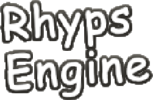
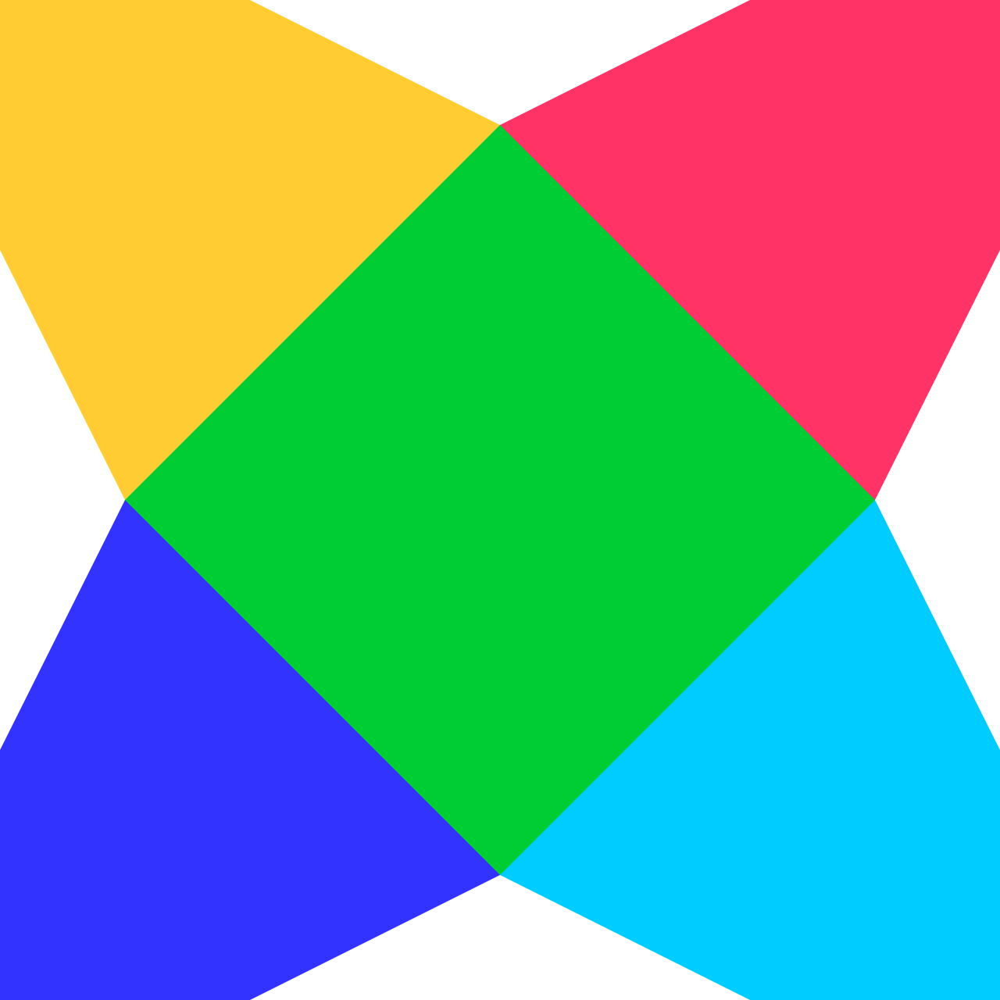

<!--titulo br-->
<h1 align="center">
   
  
   
  <b>NKL-4ever Engine</b>
   
  <i>Forever. Faster. Further.</i>
   
</h1>
<h3 align="center">
  <b>NKL-4ever is an modified Friday Night Funkin' Psych Engine Base engine focused on performance, customization and creative freedom.</b>
</h3>
<h2 align="center">
  Languages used:
</h2>

  
  

  We use Haxe for all engine files, like options mode, loading screen, freeplay, story mode and much more.
   
  And we use .lua to create scripts, events, backgrounds, and much more to make the game look better.

# Base

We're using the Psych Engine v0.71h as a base and have improved it even further! We have new mechanics, features, and tools throughout the game. Follow along and see the details below.

## Features/Performances

* **Advanced Chart System** — Support for complex and extremely large charts.
* **Performance Optimization** — Designed to handle demanding gameplay scenarios.
* **Advanced Botplay** — Support for highly complex charts.
* **Custom Content** — Characters, stages, events and HUD elements.
* **Shader Support** — Custom visual effects and stage shaders.
* **Multilanguage Scripting** — Expandable scripting architecture.
* **Debug Tools**  — Development logs and performance diagnostics.
* **Expanded Modding** — More flexibility for mod creators.
* **Android Compatibility** — Support of the first Psych NKL-4ever Engine.
* **Psych Engine but Better' Feature** - Supported Update

## Supported Languages (Planned)

* **Haxe** — Main engine language.
* **Lua** — Official scripting language.
* **Python, JavaScript, C++ and C#** — Additional scripting support.

## NKL Ecosystem
* **NKL-Bridge**: Planned system for connecting scripting languages with engine functions.
* **Charts-For-NKL-Engine**: Repository for custom charts and mods.
* **Hexgi's Top Charts**: Collection of exaggerated, difficult and humanly impossible charts.
* **Pelicirihu's Top Charts**: Collection of Sanduiche-Plays's Harder and Impossibles Charts.
* **Dave and Dave Charts**: SarahTheCharter's Extreme Dave Charts

## Documentation

* [Installation Guide](docs/installation.md)
* [Chart Editor](docs/chart-editor.md)
* [Modding Guide](docs/modding.md)
* [Android Storage System](docs/android-storage.md)
* [Mods For NKL Engine](docs/chartz-for-engine.md)
* [Changelog](CHANGELOG.md)
